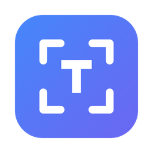
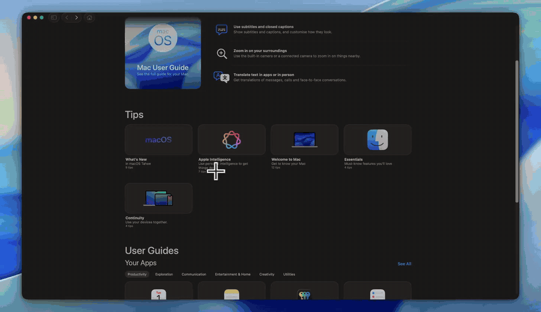
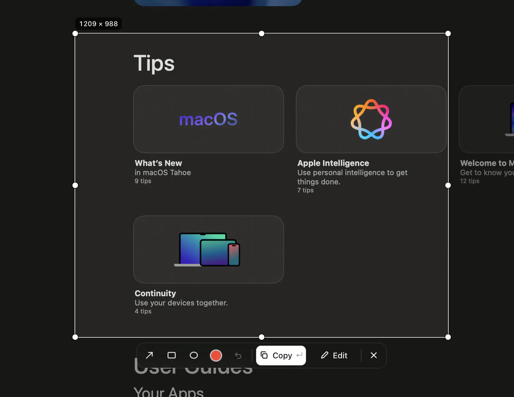
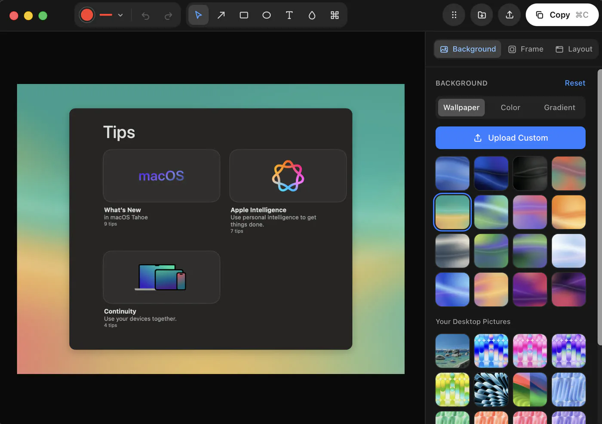
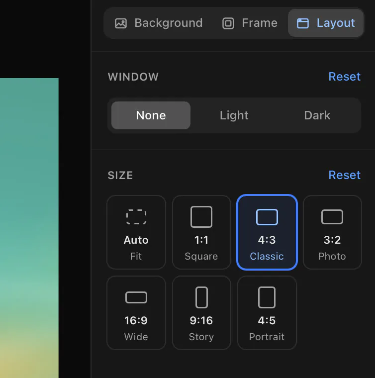
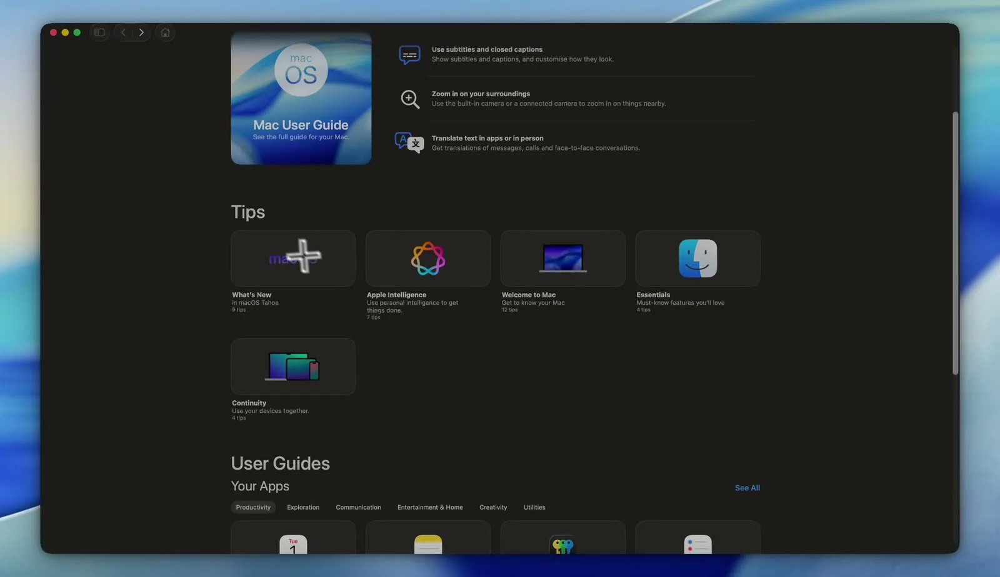

<div align="center">



# InstantShot

**Snip anything. Copy any text on screen.**

Beautiful screenshots and instant on-screen text recognition for macOS and Windows.<br />
One shortcut each, all on your device.

[](https://github.com/esaia/instantshot/releases/latest)
[](https://github.com/esaia/instantshot/releases)
[](#requirements)
[](LICENSE)
[](https://github.com/esaia/instantshot/actions/workflows/ci.yml)

[**Download for macOS**](https://github.com/esaia/instantshot/releases/latest/download/InstantShot.dmg) &nbsp;·&nbsp;
[**Download for Windows**](https://github.com/esaia/instantshot/releases/latest/download/InstantShot-Setup.exe) &nbsp;·&nbsp;
[Website](https://instantshot.vercel.app)

<br />



</div>

## Features

### 📝 Copy text from anything — <kbd>⇧</kbd><kbd>⌘</kbd><kbd>2</kbd> / <kbd>Ctrl</kbd><kbd>Shift</kbd><kbd>2</kbd>

Drag a box around any text on screen (websites, apps, paused or playing videos, images, scanned
PDFs, screen shares) and the recognized text is on your clipboard, ready to paste. Line breaks,
paragraphs and code indentation are preserved.

### 📸 Beautiful screenshots — <kbd>⇧</kbd><kbd>⌘</kbd><kbd>1</kbd> / <kbd>Ctrl</kbd><kbd>Shift</kbd><kbd>1</kbd>

Select a region and it opens in an editor that makes it presentation-ready:

- **Backgrounds** — your wallpapers, gradients or solid colors, with padding, rounded corners and shadow
- **Window chrome** — light or dark window bar
- **Size presets** — Auto, 1:1, 4:3, 3:2, 16:9, 9:16, 4:5 for posts, slides and stories
- **Markup** — arrows, boxes, ellipses, text, blur and pixelate; every shape can be moved, resized and rotated
- **Export** — copy, save, quick-save to a folder, or drag the result straight into any app

### 🔒 Private by design

OCR runs **locally** with the OS's own engine (Apple Vision on macOS, Windows.Media.Ocr on
Windows). No uploads, no accounts, no analytics. [More below](#privacy).

### 🪶 Stays out of the way

Lives in the menu bar (macOS) or system tray (Windows), with no Dock or taskbar icon. Updates
itself from GitHub releases, asking before it installs.

## Screenshots

<table>
  <tr>
    <td width="50%" valign="top">
      
      <p><b>Select.</b> Drag over anything, then adjust the edges. The screen freezes, so even a playing video holds still. Draw right away, copy, or press Edit.</p>
    </td>
    <td width="50%" valign="top">
      
      <p><b>Make it beautiful.</b> Drop it on a wallpaper, gradient or color. Add arrows, boxes, text and blur.</p>
    </td>
  </tr>
  <tr>
    <td width="50%" valign="top">
      
      <p><b>Fit where it’s going.</b> Add a window bar and pick a size: square for a post, 16:9 for slides, 9:16 for a story. Then press ⌘C.</p>
    </td>
    <td width="50%" valign="top">
      
      <p><b>Ready to share.</b> Copy it, save it, or drag it straight into Slack, Figma, a doc or a tweet.</p>
    </td>
  </tr>
</table>

## Installation

| Platform | Download | Minimum |
|---|---|---|
| **macOS** (Apple Silicon + Intel) | [`InstantShot.dmg`](https://github.com/esaia/instantshot/releases/latest/download/InstantShot.dmg) | macOS 14 Sonoma |
| **Windows** | [`InstantShot-Setup.exe`](https://github.com/esaia/instantshot/releases/latest/download/InstantShot-Setup.exe) | Windows 10 1809+ / Windows 11 |

All versions are on the [releases page](https://github.com/esaia/instantshot/releases).

### Requirements

- **macOS** needs the *Screen & System Audio Recording* permission (InstantShot asks the first
  time you capture). It does **not** use Accessibility permission.
- **Windows** needs at least one language with the *Optical character recognition* feature
  installed, and WebView2 (built into Windows 11; the installer adds it on Windows 10).

## Usage

1. Launch InstantShot. On first launch the Settings window explains the permission and shortcuts.
2. Press the shortcut. The screen dims slightly and the cursor becomes a crosshair.
3. Drag over the text. When you release, the text is copied and a small confirmation appears.
4. Paste anywhere.

To cancel, press <kbd>Esc</kbd>, press the shortcut again, or switch apps. Cancelling (or finding
no text) leaves the clipboard exactly as it was. Both shortcuts can be changed in Settings.

The menu bar / tray menu has **Capture Text**, **Capture Screenshot**, **Settings…**, **Launch at
Login**, **Check for Updates…** and **Quit**. Closing Settings keeps InstantShot running.

<details>
<summary><b>macOS Screen Recording permission</b></summary>

<br />

macOS requires Screen Recording permission for any app that reads screen pixels. Enable it in
**System Settings › Privacy & Security › Screen & System Audio Recording**, then relaunch
InstantShot (macOS applies the change only after a restart). On macOS 15 and later, the system
may occasionally ask you to re-confirm screen access. That prompt comes from macOS.

</details>

## Privacy

InstantShot never uploads screenshots or text and has no analytics or telemetry. The only
network request it makes is the daily update check against this repository's GitHub releases.

- For text capture, pixels exist only in memory for the duration of one recognition.
- A screenshot stays in memory while its editor is open and is written to disk only when you
  save it. Dragging it out writes a temporary PNG to the app's cache folder, deleted when the
  editor closes.
- Besides your saved files, the only file InstantShot writes is its settings (`settings.json` in
  the app data directory, including the editor's last style).
- Diagnostic logs record timings and errors, never captured text.

## Known limitations

- **Protected content:** DRM video, password fields in some apps, UAC/secure desktop, and other
  OS-protected surfaces are captured as black, which yields "No text found".
- **Vision** occasionally drops a line containing a single punctuation character (for example a
  lone `}` in code). Language correction is disabled so text is copied as recognized
  (identifiers, URLs and accents stay intact).
- **Languages:** OCR languages depend on the OS. Vision on macOS 26 supports 30 languages
  (Latin, Cyrillic, CJK, Arabic, Thai, Vietnamese, …) but not, for example, Georgian. Windows
  recognizes only languages whose OCR feature is installed; Settings lists what is available.
- **Shortcut conflicts:** Windows reports shortcuts already registered by other apps. macOS does
  not, so InstantShot only blocks well-known system shortcuts there.
- A selection can't span two displays (same as the macOS screenshot tool).

## Development

Built with [Tauri 2](https://tauri.app), Rust and React. Prerequisites: Rust (stable),
Node.js 20.19+ or 22+, pnpm 10, plus Xcode Command Line Tools (macOS) or the MSVC build tools and
WebView2 (Windows). See [Tauri prerequisites](https://tauri.app/start/prerequisites/).

```sh
pnpm install
pnpm tauri dev          # run in development
pnpm dev                # UI-only browser preview at http://localhost:1420 (backend simulated)
pnpm check              # TypeScript, Biome lint, Vitest
cd src-tauri && cargo fmt --check && cargo clippy --all-targets -- -D warnings && cargo test
```

`cargo test` includes real OCR runs on the fixture images in `src-tauri/tests/fixtures`.

<details>
<summary><b>Keeping the macOS permission between rebuilds</b></summary>

<br />

The Screen Recording grant is tied to the app's code signature. Ad-hoc signed builds get a new
signature on every rebuild, so macOS forgets the grant. Build a bundle signed with your own
development certificate to keep it stable:

```sh
export APPLE_SIGNING_IDENTITY="Apple Development: Your Name (TEAMID)"
pnpm tauri build --debug --bundles app
open src-tauri/target/debug/bundle/macos/InstantShot.app
```

Under `pnpm tauri dev` the permission belongs to your terminal app instead.

</details>

<details>
<summary><b>Landing page</b></summary>

<br />

The Next.js landing page is in `website/` and builds as a static site without changing the
desktop app's Vite/Tauri setup.

```sh
cd website
pnpm install
pnpm dev             # local preview
pnpm build           # static output in website/out/
```

</details>

### Further reading

- [Architecture](docs/ARCHITECTURE.md): project layout, how capture works, coordinate strategy
- [Testing](docs/TESTING.md): automated coverage and the manual test checklist
- [Releasing](docs/RELEASING.md): tagged builds, signing secrets, auto-updates, branding

## Contributing

Issues and pull requests are welcome. Please run `pnpm check` and the `cargo` checks above
before opening a PR.

## License

InstantShot is free and open source under the [MIT License](LICENSE).

<div align="center">
<sub>Made by <a href="https://x.com/esaia__">@esaia__</a></sub>
</div>
